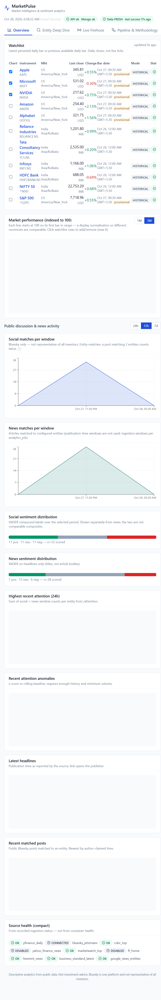
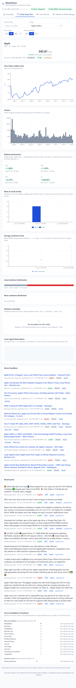
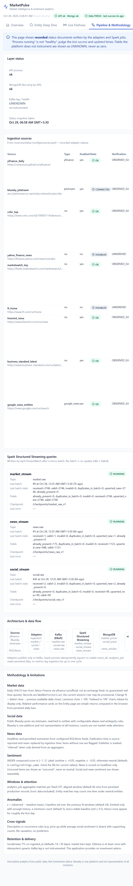

# MarketPulse

MarketPulse is a containerized market-intelligence platform that combines daily market data, public news, and Bluesky discussion into one observable dashboard. It is designed as a BDSMA college project and demonstrates an end-to-end data engineering pipeline:

**source adapters -> Kafka -> Spark Structured Streaming -> MongoDB -> FastAPI -> React dashboard**

MarketPulse is descriptive analytics only. It does not provide investment advice, execute trades, or predict returns.

## What the project provides

- Daily OHLCV history for a configured watchlist through `yfinance`.
- Live, entity-matched public posts from Bluesky Jetstream.
- RSS/Atom news ingestion from CNBC, MarketWatch, Mint, Business Standard, and Google News entity searches.
- Kafka topics for decoupled ingestion and processing.
- Spark jobs for validation, sentiment scoring, deduplicated persistence, and analytics.
- MongoDB persistence with stable event IDs and idempotent upserts.
- FastAPI REST and WebSocket endpoints for the frontend.
- A React + TypeScript dashboard with four workspaces:
  - **Overview** — watchlist, indexed performance, activity, sentiment, attention, headlines, posts, and source health.
  - **Entity Deep Dive** — one instrument’s price history, activity, sentiment, and cross-signal context.
  - **Live Firehose** — WebSocket-backed news and social event stream with filters.
  - **Pipeline & Methodology** — recorded adapter/job status and operational explanations.

## Current verified runtime

The stack was built and run locally with Docker Desktop on Windows. The dashboard was verified at [http://localhost:3000](http://localhost:3000).

At the time of verification, the running environment contained:

- 11 configured entities.
- 2,746 persisted market bars.
- 947 persisted news articles.
- 71 persisted Bluesky posts.
- API health: process `ok`, MongoDB `ok`.
- Enabled source adapters successfully producing data, including yfinance, Bluesky, CNBC, MarketWatch, Mint, Business Standard, and Google News entity feeds.
- The obsolete Yahoo Finance RSS endpoint is intentionally disabled because it returns HTTP 404/429.

Data is live and changes as providers publish new records. The values above are a verification snapshot, not a permanent fixture.

## Architecture

```text
 yfinance ---------------------> ingestion-market --\
 Bluesky Jetstream ------------> ingestion-social ---+--> Kafka
 RSS/Atom + Google News -------> ingestion-news ----/    │
                                                        │
                   market.raw --------------------------+--> spark-streaming --> MongoDB
                   social.raw/news.raw -----------------+--> spark-text ------> MongoDB
                                                               │
                                      MongoDB -----------------+--> analytics-job
                                                               │
                                      FastAPI REST/WebSocket <-+
                                                               │
                                      nginx -> React dashboard
```

### Delivery and data-quality model

1. Adapters fetch or receive external data and publish normalized event payloads to Kafka.
2. Event IDs are deterministic, so retries and Kafka redelivery do not create duplicate persisted records.
3. Spark validates the event contract and writes MongoDB documents with upsert semantics.
4. `analytics-job` scores unscored text and computes entity, attention, anomaly, and cross-signal metrics.
5. FastAPI reads persisted data only; external providers are never called during dashboard requests.
6. The UI distinguishes missing data, stale data, disabled sources, and unknown instrumentation from zero values.

## Repository structure

```text
MarketPulse/
├── apps/web/                 # React, TypeScript, Vite, Tailwind, Recharts UI
│   ├── src/api/              # REST/WebSocket client
│   ├── src/components/       # shared UI components
│   ├── src/hooks/            # API, clock, and live-feed hooks
│   ├── src/pages/            # Overview, Entity, Firehose, Pipeline
│   ├── Dockerfile equivalent # infra/docker/web.Dockerfile
│   └── nginx.conf            # SPA hosting and /api proxy
├── services/common/          # shared Pydantic contracts, config, IDs, matching, schema
├── services/ingestion/       # market, RSS/news, Bluesky adapters and Kafka publisher
├── services/streaming/       # Spark jobs, transforms, sinks, sentiment, analytics
├── services/api/              # FastAPI app, routes, repositories, response schemas
├── config/                   # watchlist, entity matching, sources, application settings
├── infra/
│   ├── compose.yaml           # complete local service graph
│   └── docker/                # API, ingestion, streaming, and web image definitions
├── scripts/                   # startup, validation, smoke tests, stack verification
├── docs/screenshots/          # dashboard evidence captured from the running frontend
├── BUILD.md                  # detailed contracts, validation, and operational notes
└── pyproject.toml             # shared Python package and test configuration
```

## Quick start on Windows

Run these commands from the repository root in PowerShell:

```powershell
Copy-Item .env.example .env
docker compose -f infra/compose.yaml --env-file .env up -d --build
docker compose -f infra/compose.yaml ps
```

Open the dashboard at [http://localhost:3000](http://localhost:3000). Useful checks:

```powershell
curl.exe http://localhost:8000/health
curl.exe http://localhost:8000/api/v1/market/watchlist
curl.exe http://localhost:8000/api/v1/news?limit=5
curl.exe http://localhost:8000/api/v1/social?limit=5
curl.exe http://localhost:8000/api/v1/sources/status
docker compose -f infra/compose.yaml logs -f ingestion-news
```

The helper [scripts/up.ps1](scripts/up.ps1) creates `.env` when needed and starts the stack.

Stop the stack without deleting data:

```powershell
docker compose -f infra/compose.yaml down
```

Deliberately delete local Kafka, MongoDB, and Spark checkpoint data:

```powershell
docker compose -f infra/compose.yaml down -v
```

## Service and port reference

| Service | Purpose | Host access |
|---|---|---|
| `kafka` | Kafka 3.9 KRaft broker | `localhost:29092` |
| `mongodb` | MongoDB 7 persistence | `localhost:27017` |
| `api` | FastAPI REST and WebSocket backend | `localhost:8000` |
| `web` | nginx-hosted React SPA | `localhost:3000` |
| `ingestion-market` | yfinance market adapter | internal |
| `ingestion-news` | RSS/Atom and Google News adapter | internal |
| `ingestion-social` | Bluesky Jetstream adapter | internal |
| `spark-streaming` | market Kafka consumer and sink | internal |
| `spark-text` | news/social consumers, validation, sentiment, sinks | internal |
| `analytics-job` | scheduled Mongo analytics computation | internal |

Ports are bound to `127.0.0.1` for local development.

## Configuration

- `.env.example` contains Docker and dashboard defaults.
- [config/watchlist.yaml](config/watchlist.yaml) defines instruments.
- [config/entities.yaml](config/entities.yaml) defines strong terms, context terms, and exclusions.
- [config/sources.yaml](config/sources.yaml) enables adapters and controls polling.
- [config/settings.yaml](config/settings.yaml) defines Kafka topics, thresholds, retention, and analytics settings.
- Leave `VITE_API_BASE_URL` and `VITE_WS_BASE_URL` empty for the recommended same-origin Docker setup.

The current source policy disables Yahoo’s retired RSS endpoint and enables entity-specific Google News RSS searches as the replacement.

## REST and WebSocket surface

| Endpoint | Function |
|---|---|
| `/health` | API process and MongoDB probe |
| `/api/v1/market/watchlist` | Latest watchlist bars and freshness |
| `/api/v1/market/{symbol}/history` | Historical daily bars |
| `/api/v1/news` | Persisted news with entity/source/sentiment filters |
| `/api/v1/social` | Persisted Bluesky posts with entity/source/sentiment filters |
| `/api/v1/entities` | Configured entity list |
| `/api/v1/entities/{id}/metrics` | Entity analytics windows |
| `/api/v1/attention` | Source-specific attention metrics |
| `/api/v1/anomalies` | Detected attention anomalies |
| `/api/v1/cross-signals` | Descriptive cross-source observations |
| `/api/v1/pipeline/status` | Recorded pipeline component status |
| `/api/v1/sources/status` | Per-source health and counters |
| `/api/v1/ws` | Live persisted event feed |

## Testing and verification

Host-side development setup:

```powershell
py -3.12 -m venv .venv
.\.venv\Scripts\Activate.ps1
pip install -e ".[dev]"
pytest
python scripts/validate_config.py
```

Stack-level verification:

```powershell
python scripts/verify_stack.py
python scripts/smoke_market.py
python scripts/smoke_text.py --live-check
```

Frontend development:

```powershell
cd apps/web
npm ci
npm run typecheck
npm test
npm run build
```

Analytics panels may initially show empty states until `analytics-job` completes a cycle. Anomaly detection requires sufficient historical windows and event volume. This is expected behavior, not fabricated zero data.

## Dashboard evidence

The following screenshots were captured from the running Docker dashboard on October 28, 2026. They are included as project evidence and illustrate the user-facing result. The Word handoff contains larger, page-safe viewport captures for readability.

### Overview — watchlist and platform health



The Overview page shows persisted market bars, API/Mongo health, source freshness, watchlist change percentages, and the dashboard’s analytics sections.

### Entity Deep Dive — Apple



The Entity Deep Dive page demonstrates entity selection, price context, daily-bar freshness, and the per-entity analytics surface.

### Live Firehose — WebSocket feed


The Firehose page shows the open WebSocket connection, server heartbeat, event filters, and the distinction between replayed snapshots and newly ingested events.

### Pipeline & Methodology — operational transparency



The Pipeline page exposes recorded adapter/job status. Values that are not instrumented are shown as `UNKNOWN`, rather than being presented as falsely healthy.

## Known limitations

- yfinance is an unofficial provider and supplies daily bars rather than live trade ticks.
- Bluesky is one public platform and is not representative of all investors.
- RSS publishers can change URLs, rate-limit clients, or return malformed-but-usable feeds; source health is recorded in the API and UI.
- Kafka lag and some Spark runtime details are currently reported as `UNKNOWN` because they are not instrumented.
- Sentiment uses VADER; news scoring is based on headlines rather than article bodies.
- At-least-once delivery is used with idempotent upserts; the system is not exactly-once.
- The local development stack has no authentication and is intended for localhost use.

## Team demo guide

For a detailed four-person ownership split, implementation walkthrough, file-by-file explanation, and presentation talking points, see [MarketPulse Project Handoff - Updated.docx](MarketPulse%20Project%20Handoff%20-%20Updated.docx).

## License and academic context

This repository is an academic project. Check the repository’s governing course or institution requirements before redistributing provider content or deploying the system publicly.
